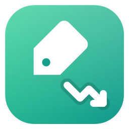
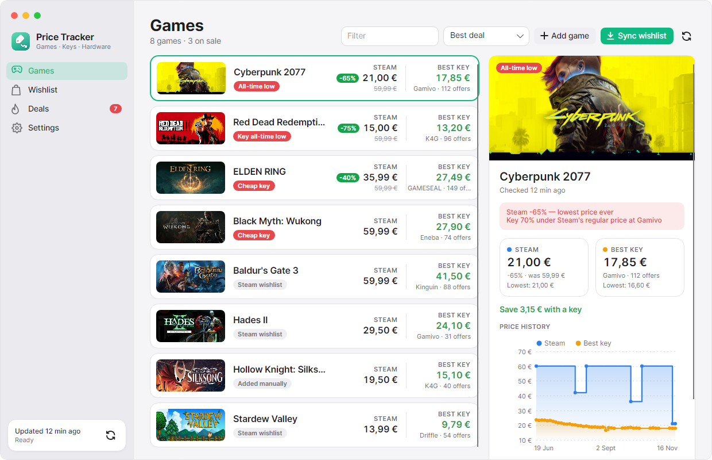
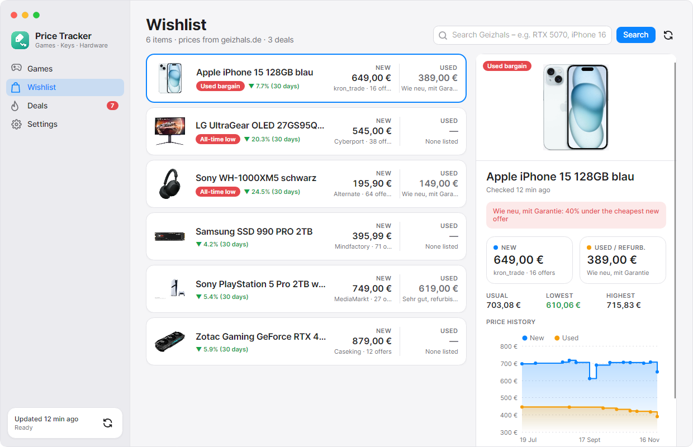
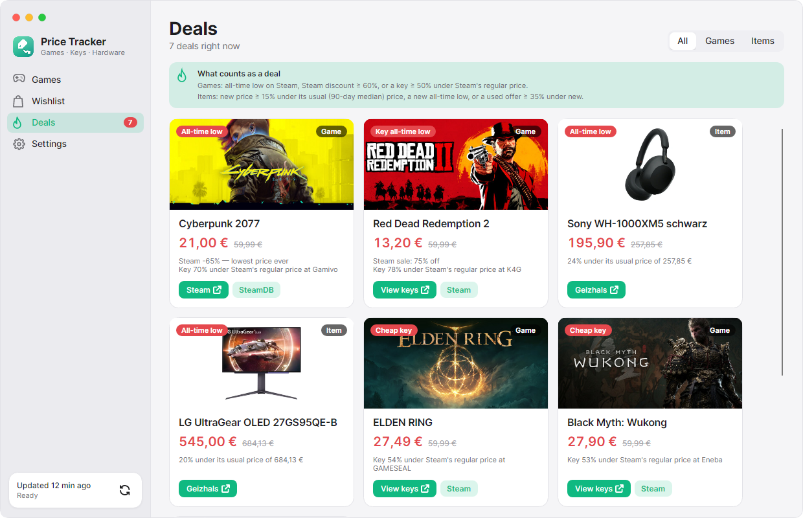
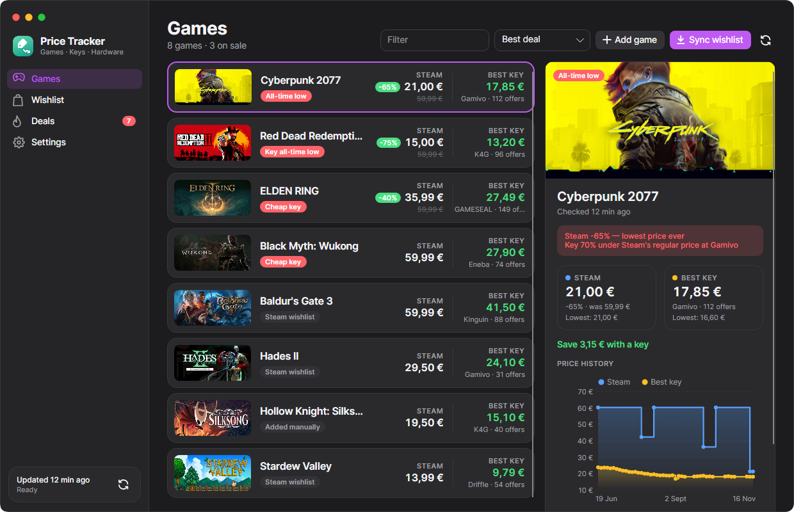
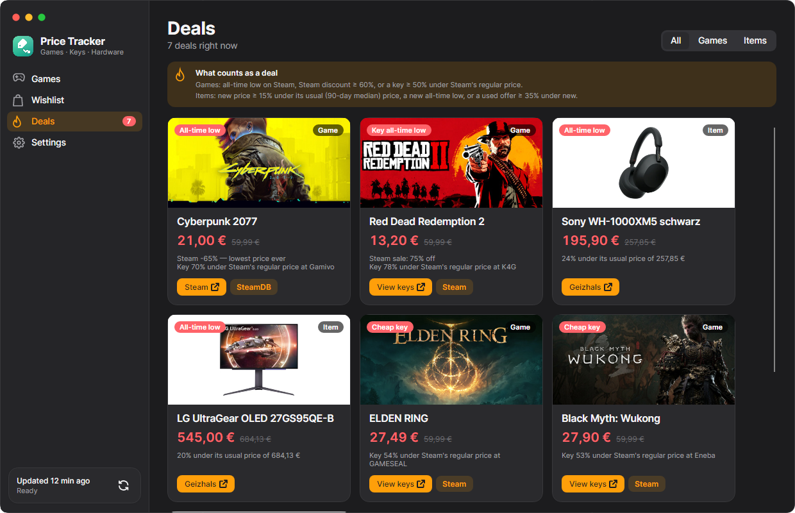
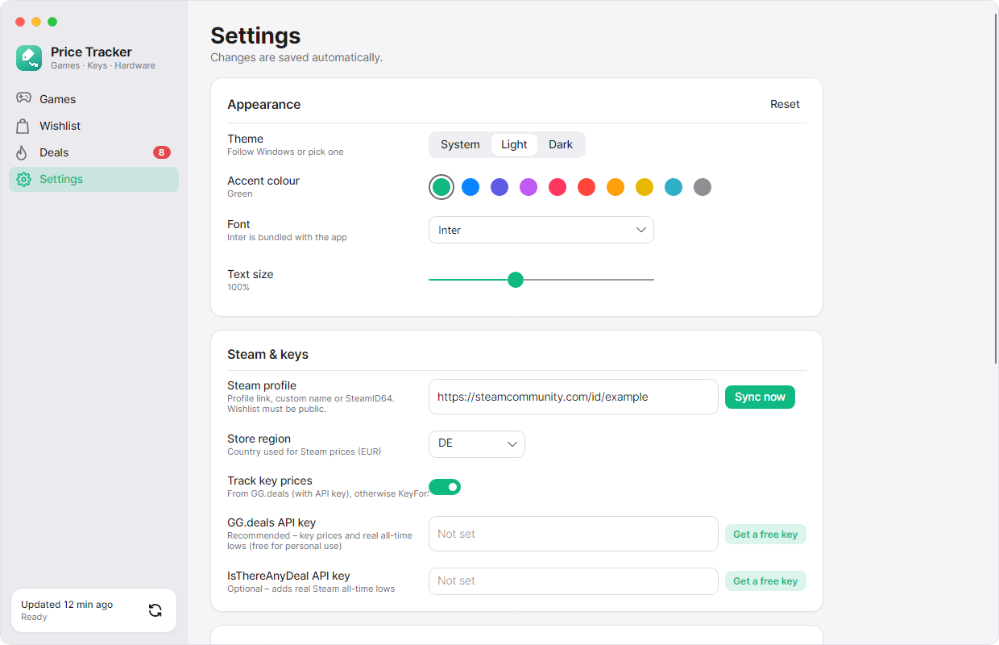
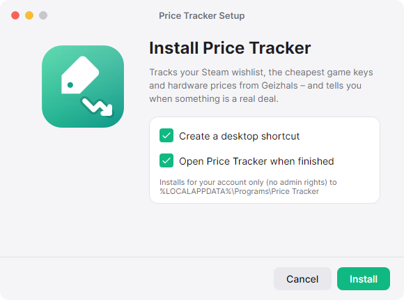

<p align="center">
  
</p>

<h1 align="center">Price Tracker</h1>

<p align="center">
  <b>Your Steam wishlist, the cheapest game keys and hardware prices – in one calm, Mac-style Windows app.</b><br/>
  Built with C# / .NET 10 and Avalonia UI.
</p>

<p align="center">
  
  
  
  
</p>

<p align="center">
  
</p>

---

## What it does

Price Tracker has three dashboards.

| | |
|---|---|
| **🎮 Games** | Imports your **Steam wishlist** and follows every game's Steam price, discount and regular price, plus the **cheapest key** from [KeyForSteam](https://www.keyforsteam.de). Each game links to its Steam page, its key offers and its [SteamDB](https://steamdb.info) price history. |
| **🛍️ Wishlist** | Search **[Geizhals](https://geizhals.de)** right inside the app and track any product. Price Tracker records the **cheapest new price** (with shop and number of offers) and the cheapest **used / refurbished** offer. |
| **🔥 Deals** | Everything that is *way* cheaper than usual, in one place – games at an **all-time low**, big Steam sales, unusually cheap keys and items far below their usual price. |

Every game and item has an interactive **price-history chart** (hover for exact prices) and one-click links to the store, the key shop or the Geizhals offer list.

### When is something a deal?

| Type | Rule (defaults, adjustable in Settings) |
|---|---|
| Game – all-time low | Steam price is discounted and at or below the lowest price ever seen – from GG.deals or IsThereAnyDeal (free API keys), or from 60+ days of history recorded by Price Tracker. Without that, a sale is never called an all-time low. |
| Game – big sale | Steam discount ≥ **60 %** |
| Game – cheap key | Cheapest key ≥ **50 %** under Steam's regular price (key prices from GG.deals, or KeyForSteam as fallback) |
| Item – below usual | Cheapest new price ≥ **15 %** under its *usual price* (median of the last 90 days, needs ≥ 3 days of history) |
| Item – all-time low | New price lower than ever recorded (≥ 7 days of history, ≥ 3 % under usual) |
| Item – used bargain | A used / refurbished offer ≥ 35 % under the cheapest new offer |

The 15 % item threshold was chosen because normal retail prices on Geizhals drift by roughly ±5 % week to week; 15 % filters that noise out while still catching real sales (Black Friday, Prime Day, shop clearances).

## Screenshots

<table>
  <tr>
    <td></td>
    <td></td>
  </tr>
  <tr>
    <td align="center"><sub>Wishlist – new &amp; used prices from Geizhals</sub></td>
    <td align="center"><sub>Deals – everything unusually cheap right now</sub></td>
  </tr>
  <tr>
    <td></td>
    <td></td>
  </tr>
  <tr>
    <td align="center"><sub>Dark mode · purple accent</sub></td>
    <td align="center"><sub>Dark mode · orange accent</sub></td>
  </tr>
  <tr>
    <td></td>
    <td></td>
  </tr>
  <tr>
    <td align="center"><sub>Settings – theme, accent colour, font, text size, thresholds</sub></td>
    <td align="center"><sub>Installer (with uninstall option)</sub></td>
  </tr>
</table>

<sub>Screenshots use sample data; prices shown are illustrative.</sub>

## Features

- **Apple-style UI** – rounded corners, macOS "traffic light" window buttons (close / minimise / zoom), sidebar navigation, cards and smooth transitions.
- **Customisable look** – light, dark or follow-Windows theme; 10 accent colours; any installed font (Inter is bundled); text size 85 – 125 %.
- **Steam wishlist sync** – paste your profile link, custom name or SteamID64. Games removed from the wishlist stop being tracked; games you add by hand stay.
- **Add games manually** from a built-in Steam store search.
- **Key prices** from KeyForSteam, with the shop and number of offers.
- **Geizhals search & tracking** with new and used / refurbished prices.
- **Price history charts** for every game and item.
- **Automatic refresh** every 1 – 24 hours while the app is open, or on demand.
- **Everything stays on your PC** – no account, no telemetry. Data lives in `%APPDATA%\PriceTracker`.
- **Installer with uninstaller** – per-user install (no admin rights), Start-menu and optional desktop shortcut, listed in *Settings › Apps* where it can be uninstalled.

## Install

Download from the [Releases](../../releases) page:

| File | What it is |
|---|---|
| `PriceTrackerSetup.exe` | Installer. Installs to `%LOCALAPPDATA%\Programs\Price Tracker`. Run it again (or use *Settings › Apps*) to update or uninstall. |
| `PriceTracker.exe` | Portable version – a single self-contained file, nothing to install. |

Requirements: Windows 10 (1809+) or Windows 11, 64-bit. No .NET installation needed. Geizhals and the "human check" fallback use the **Microsoft Edge WebView2 runtime**, which is part of Windows 11 and almost every Windows 10 PC.

Silent install / uninstall for scripting:

```powershell
PriceTrackerSetup.exe /quiet
"%LOCALAPPDATA%\Programs\Price Tracker\Uninstall Price Tracker.exe" /uninstall /quiet
```

## Getting started

1. Open **Settings** and enter your Steam profile link (your wishlist must be visible – Steam › Privacy settings › *Game details: Public*).
2. Press **Sync wishlist** on the Games dashboard.
3. Go to **Wishlist**, search for a product (e.g. *RTX 5070*, *PlayStation 5 Pro*) and press **Track**.
4. Check **Deals** now and then – or just glance at the red badge in the sidebar.
5. **Recommended:** add a free [GG.deals API key](https://gg.deals/api/) in Settings for key prices and real all-time lows from day one. (An [IsThereAnyDeal key](https://isthereanydeal.com/apps/my/) works too for Steam-only lows.)

## How prices are collected

| Source | How |
|---|---|
| Steam | Public store endpoints (`IWishlistService`, `IStoreBrowseService`, `appdetails`, store search). No API key. |
| GG.deals | Official prices API with your own free key (personal use): cheapest key-shop price plus real all-time lows. Shown with a "Prices by GG.deals" link, as GG.deals requires. **Recommended.** |
| KeyForSteam | Fallback when no GG.deals key is set. The public product page (its structured `AggregateOffer` data) and the site's quick search. Requests are spaced 8 s apart and paused automatically if the site is unreachable – AllKeyShop's network blocks clients that ask too fast. |
| Geizhals | Loaded in an embedded Microsoft Edge (WebView2) – exactly like opening the page in a browser – one page at a time with pauses in between. If the site ever asks for a "confirm you're human" check, Price Tracker shows that page and **you** complete it; the app never tries to solve or bypass such checks. |
| SteamDB | Linked, not scraped – SteamDB asks people not to scrape it, so "SteamDB" buttons open its price-history page in your browser. |
| IsThereAnyDeal | Optional, official API with your own key. |

Price Tracker is a personal tool: please keep refresh intervals reasonable. It is not affiliated with Valve, KeyForSteam/AllKeyShop, Geizhals, SteamDB or IsThereAnyDeal. Website layouts change – if a source stops working, please open an issue.

## Build from source

Requirements: [.NET 10 SDK](https://dotnet.microsoft.com/download) on Windows.

```powershell
git clone https://github.com/HenningDev1/PriceTracker.git
cd PriceTracker
dotnet run --project src/PriceTracker
```

Scripts (run from the repo root with `powershell -ExecutionPolicy Bypass -File …`):

| Script | Purpose |
|---|---|
| `scripts/build-release.ps1` | Builds `Release\PriceTracker.exe` (portable) and `Release\PriceTrackerSetup.exe` (installer). |
| `scripts/screenshots.ps1` | Re-renders the README screenshots from sample data (your real data is never touched). |
| `scripts/selftest.ps1` | Live check of every data source (Steam, KeyForSteam, Geizhals) – handy when a site changes its layout. |
| `scripts/make-icon.ps1` | Redraws the app icon (`app.ico` + PNGs). |

### Project layout

```
src/
  PriceTracker/            the app (Avalonia, MVVM with CommunityToolkit.Mvvm)
    Models/                GameEntry, ItemEntry, PricePoint, AppSettings
    Services/              Steam, KeyForSteam, Geizhals, IsThereAnyDeal, WebView2 fetcher,
                           tracker (refresh + history), deal rules, theming, storage
    ViewModels/            one view model per dashboard + settings
    Views/                 MainWindow (sidebar + traffic lights), Games, Wishlist, Deals, Settings
    Controls/PriceChart.cs custom-drawn price-history chart
  Installer/               PriceTrackerSetup.exe – Avalonia installer / uninstaller with embedded payload
scripts/                   build, screenshot, self-test and icon scripts
docs/                      icon and screenshots for this README
```

## License

[MIT](LICENSE) © 2026 HenningDev
